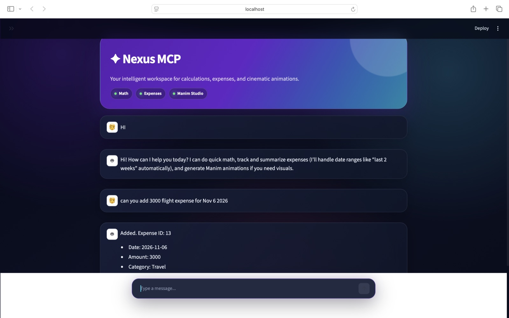
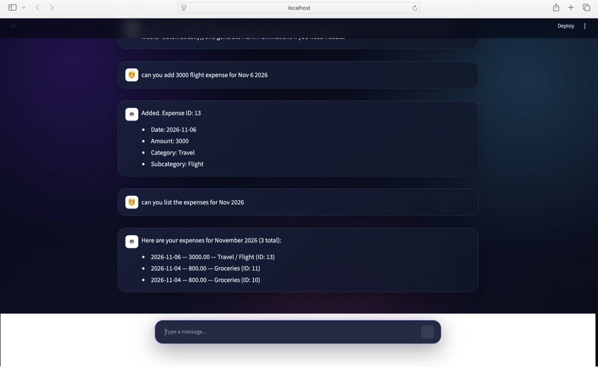
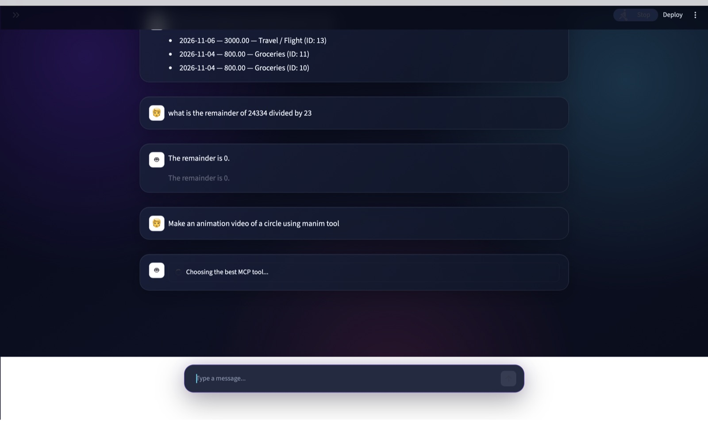
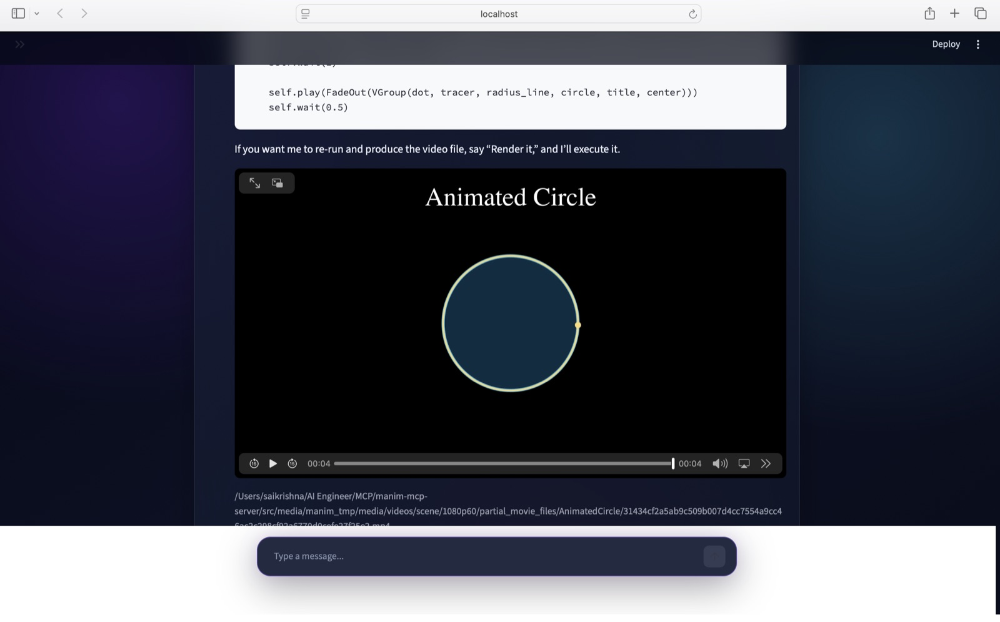
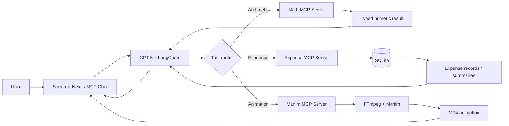

# Nexus MCP — Multi-Server AI Workspace


Nexus MCP is a portfolio-grade Model Context Protocol project that connects one
AI chat experience to three independent MCP servers. The application discovers
typed tools at runtime, lets GPT-5 choose the right capability, executes that
tool over MCP, and streams the grounded result back to a premium Streamlit UI.

The project demonstrates more than a chatbot: it shows protocol-based tool
discovery, multi-server orchestration, structured function calling, local
process isolation, persistent data access, media generation, streaming, testing,
and a production-minded user experience.

## Demo

### Expense creation through natural language



### Expense retrieval with structured MCP results



### Math and Manim tool routing



### Generated Manim animation rendered inside the chat



## What this project demonstrates

- A single client orchestrating multiple MCP servers over STDIO.
- Runtime tool discovery through `MultiServerMCPClient`.
- GPT-5 tool selection with structured arguments.
- Correct tool-result handoff using `ToolMessage` and `tool_call_id`.
- Streaming model output in a stateful Streamlit chat interface.
- Relative-date reasoning for requests such as “expenses from the last 2 weeks.”
- SQLite-backed expense persistence with typed validation.
- Programmatic Manim code execution and inline video playback.
- Independent Python environments and lockfiles for each service.
- Automated tests for the math and expense MCP servers.

## Architecture



### Request lifecycle

1. The client starts each local MCP server as an isolated STDIO subprocess.
2. LangChain discovers the tools and their JSON schemas.
3. The user enters a natural-language request in Streamlit.
4. GPT-5 selects a tool and generates validated arguments.
5. The client invokes the selected MCP tool.
6. A `ToolMessage` links the result to the original tool-call ID.
7. GPT-5 produces a grounded final response, streamed into the chat.
8. For Manim requests, the generated MP4 is displayed inline.

## MCP servers and tools

| Server | Tool | Purpose |
|---|---|---|
| Math | `add` | Add two numbers |
| Math | `subtract` | Subtract one number from another |
| Math | `multiply` | Multiply two numbers |
| Math | `divide` | Divide with zero validation |
| Math | `power` | Raise a base to an exponent |
| Math | `modulo` | Calculate a remainder |
| Math | `square_root` | Calculate a validated square root |
| Expense | `add_expense` | Persist a categorized expense |
| Expense | `list_expenses` | Retrieve expenses in an inclusive date range |
| Expense | `summarize` | Aggregate spending by category |
| Manim | `execute_manim_code` | Render model-generated Manim code |
| Manim | `cleanup_manim_temp_dir` | Remove generated temporary media |

## Repository structure

```text
.
├── main.py                         # Gateway-compatible expense entry point
├── categories.json                 # Gateway-compatible category data
├── tests/                          # Gateway-compatible expense tests
├── app/
│   ├── client1.py                  # Terminal multi-server client
│   ├── client2.py                  # Premium Streamlit chat client
│   ├── .env.example
│   ├── pyproject.toml
│   └── uv.lock
├── modules/
│   ├── math-server/
│   │   ├── main.py
│   │   ├── tests/
│   │   ├── pyproject.toml
│   │   └── uv.lock
│   ├── expense-server/
│   │   ├── main.py
│   │   ├── categories.json
│   │   ├── tests/
│   │   ├── pyproject.toml
│   │   └── uv.lock
│   └── manim-server/
│       ├── src/manim_server.py
│       ├── pyproject.toml
│       ├── uv.lock
│       └── LICENSE.txt
└── docs/images/                    # README screenshots
```

## Technology stack

- **Protocol:** Model Context Protocol (MCP)
- **Servers:** FastMCP and the Python MCP SDK
- **Orchestration:** LangChain MCP Adapters
- **Model:** OpenAI GPT-5
- **Frontend:** Streamlit
- **Persistence:** SQLite
- **Animation:** Manim Community + FFmpeg
- **Environment management:** `uv`
- **Testing:** pytest

## Local setup

### Prerequisites

- Python 3.13
- [`uv`](https://docs.astral.sh/uv/)
- Node.js only if you want to use MCP Inspector
- macOS Homebrew packages required by Manim:

```bash
brew install cairo pango pkg-config ffmpeg
```

### 1. Clone the repository

```bash
git clone https://github.com/saikrishnareddy1731/test-remote-mcp-server.git
cd test-remote-mcp-server
```

### 2. Install each isolated environment

```bash
# Gateway-compatible expense server at repository root
uv sync

# Expense server used by the local multi-server client
cd modules/expense-server
uv sync
cd ../..

# Math server
cd modules/math-server
uv sync
cd ../..

# Manim server
cd modules/manim-server
uv sync
cd ../..

# Multi-server clients
cd app
uv sync
cd ..
```

Each service has its own `pyproject.toml`, lockfile, and virtual environment.
The client resolves all server paths relative to the cloned repository, so no
developer-specific absolute paths are required.

### 3. Configure OpenAI

```bash
cp app/.env.example app/.env
```

Add your key to `app/.env`:

```dotenv
OPENAI_API_KEY=your_openai_api_key_here
```

The `.env` file is ignored by Git and must never be committed.

### 4. Launch the premium chat UI

```bash
cd app
uv run streamlit run client2.py
```

Open [http://localhost:8501](http://localhost:8501).

Example prompts:

```text
What is the remainder of 24334 divided by 23?
Add a 3000 INR flight expense for November 6, 2026.
Show all expenses from the last two weeks.
Create a Manim animation of a circle with a point moving around its edge.
```

### Terminal client

```bash
cd app
uv run client1.py
```

## Testing

Run both tested server suites:

```bash
uv run pytest

cd modules/expense-server
uv run pytest
cd ../..

cd modules/math-server
uv run pytest
```

Expected result:

```text
Expense server: 2 tests passed
Expense module: 2 tests passed
Math server:    3 tests passed
```

## Inspecting individual MCP servers

Expense server:

```bash
npx -y @modelcontextprotocol/inspector@0.17.2 \
  uv run fastmcp run main.py --no-banner
```

Math server:

```bash
cd modules/math-server
npx -y @modelcontextprotocol/inspector@0.17.2 \
  uv run fastmcp run main.py --no-banner
```

The Inspector displays each tool schema and allows direct invocation without the
LLM client.

## Expense persistence and deployment

Locally, expenses are stored in `expenses.db`, which is ignored by Git. In a
read-only hosted container, the server falls back to
`/tmp/expense-tracker/expenses.db`. For durable production data, set:

```bash
EXPENSE_DB_PATH=/path/to/persistent/volume/expenses.db
```

The expense server can run over HTTP for remote MCP clients. The math and Manim
servers use STDIO in this project because they are launched and supervised by
the local orchestration client.

The expense implementation also lives in `modules/expense-server/`, alongside
the Math and Manim services. The root entry point is retained intentionally so
existing FastMCP Gateway deployments can continue launching `main.py` without a
configuration change.

## Engineering decisions

### Why separate MCP servers?

Each domain owns a focused tool contract and dependency set. Math remains tiny,
expense tracking owns SQLite and validation, and Manim isolates heavyweight
rendering dependencies. The client composes them without merging their business
logic.

### Why STDIO locally?

STDIO avoids ports, authentication, and network configuration for local tools.
The client controls each subprocess lifecycle and MCP carries structured messages
over standard input/output.

### Why preserve the tool-call ID?

The final model request includes a `ToolMessage` with the original
`tool_call_id`. This is the protocol-level association that tells the model
which requested operation produced the returned data.

### Why stream only user-facing text?

Tool-call arguments arrive as structured streaming chunks and may contain no
visible prose. The UI shows a concise progress state while accumulating those
chunks, then streams the grounded final answer after tool execution.

## Security and repository hygiene

- API keys remain in the ignored `app/.env` file.
- SQLite databases, virtual environments, caches, and generated media are ignored.
- Tool inputs are typed and validated before execution.
- Division by zero and invalid square roots return controlled errors.
- Production Manim execution should be sandboxed before accepting untrusted users,
  because the tool intentionally executes generated Python animation code.

## Interview talking points

- How MCP standardizes tool discovery and invocation across independent services.
- Why structured tool schemas are more reliable than parsing free-form model text.
- How a tool call becomes a `ToolMessage` and feeds a grounded final answer.
- Tradeoffs between STDIO for local orchestration and HTTP for remote deployment.
- Isolating heavyweight native dependencies such as Cairo and FFmpeg.
- Handling relative dates deterministically with application-provided context.
- Designing a responsive UI around tool calls that do not emit visible tokens.

## Attribution

The Manim MCP module is derived from the MIT-licensed
[`abhiemj/manim-mcp-server`](https://github.com/abhiemj/manim-mcp-server).
Its original license is retained at `modules/manim-server/LICENSE.txt`.

## Author

Built by **Sai Krishna Reddy Ragula** as an end-to-end demonstration of MCP,
LLM tool orchestration, typed Python services, persistent data, generative
animation, and streaming AI UX.
